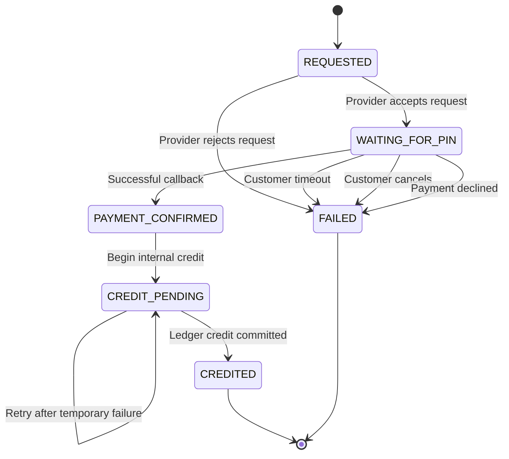

    - A deposit may only be credited after a verified successful provider callback.
    - Duplicate callbacks must not create duplicate credits.
    - A confirmed payment must not become failed because of a temporary internal error.
    - CREDIT_PENDING operations must be safely retryable.