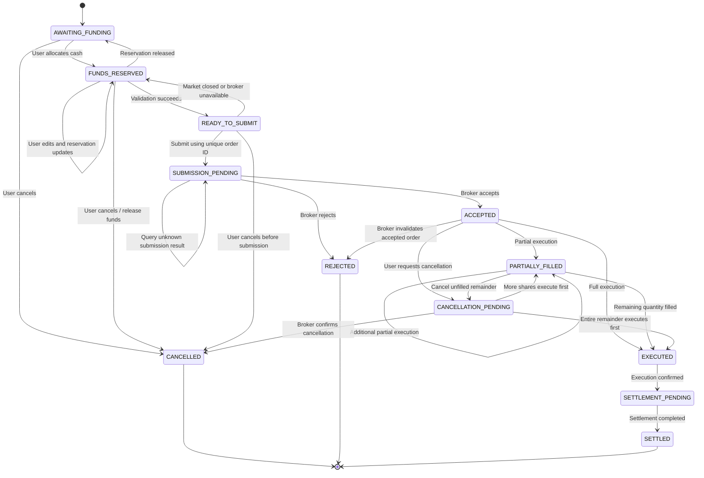

- An order must never be submitted without sufficient reserved funds.
- The same reservation cannot fund multiple orders.
- Editing an order must atomically update both the order and its reservation.
- Repeated submission of the same order must not create duplicate broker orders.
- A submitted cancellation is a request until the broker confirms it.
- A partially filled order may cancel only its unfilled quantity.
- Every execution must be permanently recorded.
- Orders are never deleted, including rejected and cancelled orders.
- Temporary market or broker unavailability must not be represented as order rejection. 