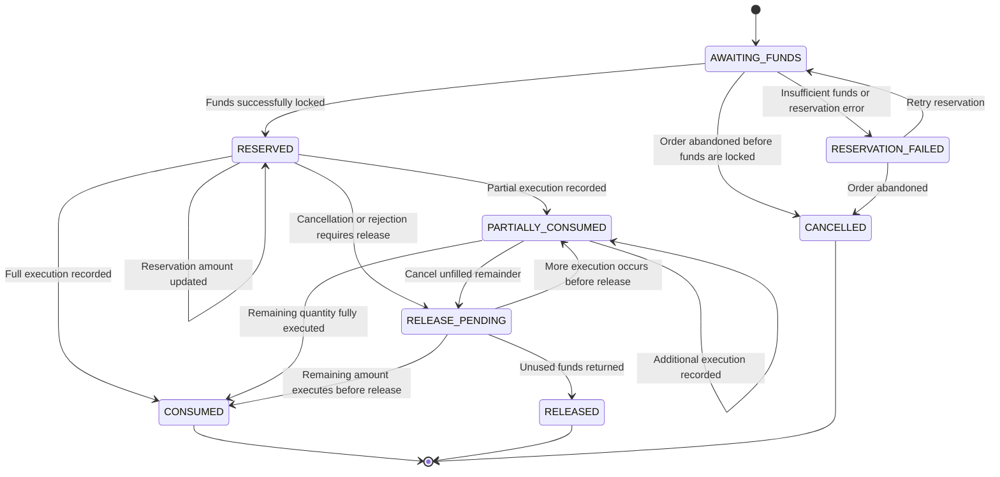

Key rules:

- Only one active reservation may exist for an order.
- A reservation belongs to exactly one order.
- Executed value becomes consumed; unexecuted value remains reserved.
- Rejection or confirmed cancellation releases only unused funds.
- Consuming or releasing funds must be idempotent.
- Reservation and balance updates must be atomic.
- Terminal reservations are never reopened or deleted.