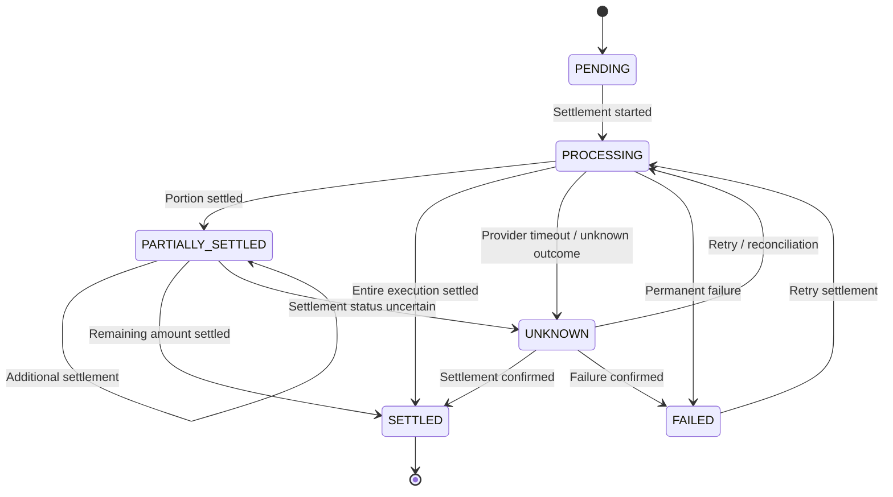

Invariants
- A settlement belongs to exactly one execution.
- An execution may have multiple settlement records.
- Settled amount can never exceed the executed amount.
- Once an amount is settled, it can never become unsettled.
- Every successful settlement must produce immutable ledger entries.
- Settlement retries must be idempotent.
- Completed settlement records are never deleted.